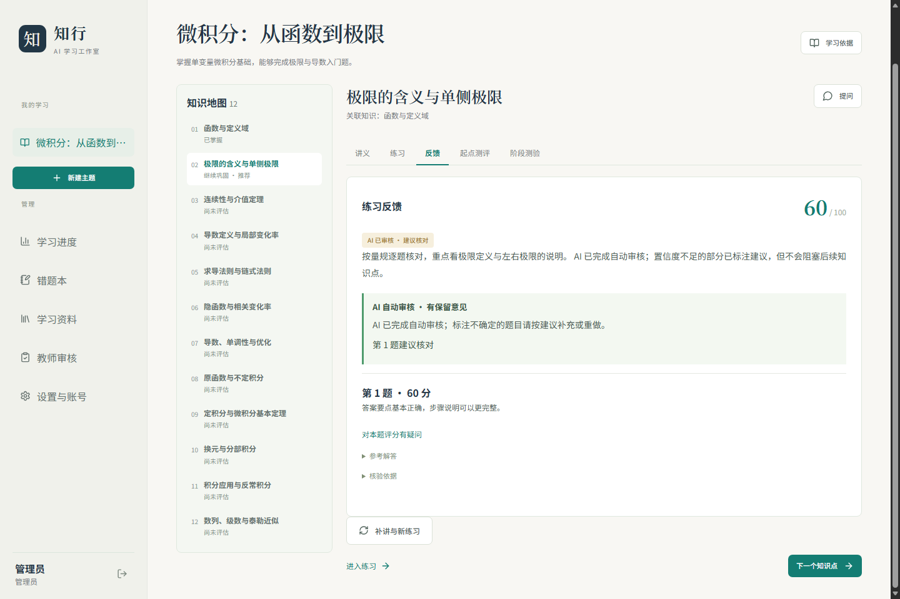
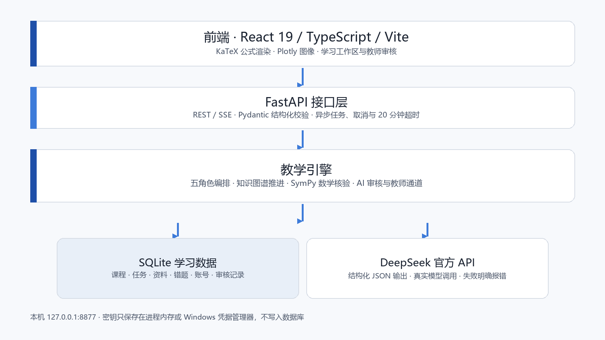
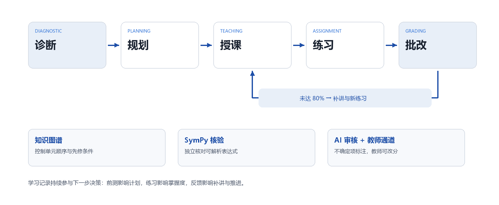

# 知行：个性化多智能体学习工作室

> 面向大学生的本机智能授课系统 · 版本 **1.3.1**

学生输入学习主题、已有基础、学习目标和每周可投入时间，系统通过起点测评了解学情，再由**诊断、规划、授课、练习、批改**五个结构化角色生成个性化课程，并依据真实作答决定继续、补讲或完成。知识依赖图约束学习顺序，SymPy 核验可解析的数学表达式，AI 审核与教师审核通道共同约束评分结果。



## 目录

- [核心功能](#核心功能)
- [快速开始](#快速开始)
- [配置 DeepSeek 密钥](#配置-deepseek-密钥)
- [技术架构](#技术架构)
- [课程与题库](#课程与题库)
- [项目结构](#项目结构)
- [验证记录](#验证记录)
- [文档与答辩材料](#文档与答辩材料)
- [团队](#团队)
- [数据与隐私](#数据与隐私)
- [常见问题](#常见问题)

## 核心功能

**学生端**

- 任意主题建课：主题、基础、目标、每周时间、每次时长、学习偏好。
- 起点测评：3 道诊断题；未测单元保持“未知”，不虚构已掌握。
- 个性化计划：单元顺序、每单元时长、重点与先修关系。
- 分层讲义：概念讲解、例题、易错点、来源引用，KaTeX 渲染公式。
- 练习与反馈：按当前单元生成题目、量规和三级提示；逐题得分与错因定位。
- 补讲与新练习：未达 80% 时针对错因重新讲解，而不是直接推进。
- 评分申诉：每题一次 AI 重新批改，原分保留可见。
- 错题本：低于 80% 的题按 1、3、7 天安排复习。
- 阶段测验：12 单元课程提供前测、后测、延迟测。
- 学习助手：划选讲义文字提问，按提示层级逐步给思路。
- 学习进度：掌握单元、练习次数、平均分、待复习错题，可导出或删除。

**教师 / 管理员端**

- 教师审核：查看 AI 建议核对的记录，确认或改分，改分后重算掌握度。
- 学员进度：掌握单元、练习次数、平均分、待复习错题与模型用量，不显示作答内容。
- 账号管理：添加、停用、删除账号，重置密码，设置角色。
- 密钥管理：先验证再保存 DeepSeek Key；Windows 可存入凭据管理器。
- 数据管理：SQLite 备份下载、脱敏错误日志、网页退出程序。

**工程能力**

- Windows 免安装包：双击 EXE 启动，无控制台，自动打开 `http://127.0.0.1:8877/`。
- 跨平台源码运行：Windows / macOS / Linux；前端构建产物已随仓库提供。
- 异步任务：进度、取消、20 分钟超时；`request_id` 幂等。
- 多账号隔离：课程、任务、错题、资料、测验互不可见。
- 失败可见：模型或网络故障明确报错，不用模拟内容替代真实生成。

## 快速开始

### 方式一：Windows 免安装包（推荐给演示和试用）

1. 打开仓库的 **Releases** 页面，下载 `ZhixingLearningStudio-Windows-1.3.1.zip`。
2. 解压整个文件夹，双击 `ZhixingLearningStudio.exe`。不要只复制 EXE。
3. 浏览器会自动打开 `http://127.0.0.1:8877/`。首次使用创建管理员账号。
4. 在“设置与账号”里填写 DeepSeek API Key，验证并保存。

学习数据保存在 `%LOCALAPPDATA%\ZhixingLearningStudio\learning.sqlite`。再次双击只重新打开页面；退出由管理员在网页“设置与账号”中操作。

### 方式二：Windows 源码运行

需要 **Python 3.11+**。前端已带构建产物，不需要安装 Node.js。

```powershell
# 在仓库根目录
.\start.cmd
```

或手动执行：

```powershell
python -m venv .venv
.\.venv\Scripts\python.exe -m pip install -r requirements.txt
.\.venv\Scripts\python.exe scripts\serve.py
```

`start.cmd` 会检查 Python 版本、创建虚拟环境、安装依赖，并在缺少 `frontend/dist` 时用 Node.js 20+ 构建前端。

### 方式三：macOS / Linux 源码运行

需要 **Python 3.11+**；只有在没有 `frontend/dist` 时才需要 Node.js 20+。

```bash
./start.sh
```

或手动执行：

```bash
python3 -m venv .venv
.venv/bin/python -m pip install -r requirements.txt
.venv/bin/python scripts/serve.py
```

浏览器打开 `http://127.0.0.1:8877/`。默认数据库为 `data/learning.sqlite`，可用 `--db` 或环境变量 `LEARNING_DB` 指定其他位置；端口冲突时用 `--port` 换端口。

## 配置 DeepSeek 密钥

系统运行时只调用 **DeepSeek 官方 API**（`https://api.deepseek.com`）。

1. 用管理员账号登录，进入“设置与账号”。
2. 粘贴 DeepSeek API Key，点击“验证并保存”。
3. Windows 免安装包可勾选“记住密钥”，保存到 Windows 凭据管理器；不勾选则仅本次运行有效。
4. macOS / Linux 源码方式只保存在进程内存，重启后需重新填写。

密钥不会写入 SQLite、课程记录、日志或截图。也可以在启动前设置 `DEEPSEEK_API_KEY` 环境变量；已保存的网页设置优先。

## 技术架构



| 层次 | 技术 | 作用 |
| --- | --- | --- |
| 前端 | React 19、TypeScript、Vite、KaTeX、Plotly | 学习工作区、公式与图像、教师审核 |
| 接口 | FastAPI、Pydantic、REST / SSE | 异步任务、结构化校验、权限与同源保护 |
| 教学 | 五角色编排、知识图谱、SymPy、审核策略 | 诊断、规划、授课、练习、批改、补讲 |
| 数据 | SQLite | 课程、任务、资料、错题、账号、审核记录 |
| 模型 | DeepSeek 官方 API | 结构化 JSON 输出与真实生成 |
| 交付 | PyInstaller | Windows 免安装程序 |



五个角色是同一编排引擎中的任务分工，不是五个独立模型或五个自治进程。完整接口约定见 [`docs/API.md`](docs/API.md)。

## 课程与题库

`knowledge/calculus.json` 包含 12 个单元、36 道基准题、3 个开放来源及先修关系：

| 单元 | 主题 | 单元 | 主题 |
| --- | --- | --- | --- |
| u01 | 函数与定义域 | u07 | 导数、单调性与优化 |
| u02 | 极限的含义与单侧极限 | u08 | 原函数与不定积分 |
| u03 | 连续性与介值定理 | u09 | 定积分与微积分基本定理 |
| u04 | 导数定义与局部变化率 | u10 | 换元与分部积分 |
| u05 | 求导法则与链式法则 | u11 | 积分应用与反常积分 |
| u06 | 隐函数与相关变化率 | u12 | 数列、级数与泰勒近似 |

来源：OpenStax Calculus Volume 1/2、MIT OCW 18.01SC。

## 项目结构

```text
zhixing-learning-studio/
├─ learning/            后端：API、引擎、账号、数据库、数学核验、审核策略
├─ frontend/            React 前端；dist/ 为已构建产物
├─ knowledge/           12 单元微积分课程与题库
├─ tests/               后端 pytest
├─ scripts/             启动、构建、浏览器检查、发布核验
├─ docs/                结题报告、答辩 PPT、文稿、API 契约、用户指南
├─ evidence/            测试与发布证据、界面截图
├─ desktop.py           Windows 桌面启动器
├─ credential_vault.py  Windows 凭据管理器适配
├─ start.cmd             Windows 一键启动
├─ start.sh             macOS / Linux 一键启动
└─ requirements.txt     Python 依赖
```

## 验证记录

| 检查项 | 结果 | 说明 |
| --- | --- | --- |
| 后端自动化测试 | **136 passed** | `pytest -q`，离线夹具 |
| 前端单元测试 | **13 passed** | `node --test frontend/tests/*.test.mjs` |
| 浏览器端到端检查 | **15 / 15** | Edge 无头模式、临时数据库、离线桩 |
| Windows 发布包检查 | **20 / 20** | 冻结 EXE 自检、真实 HTTP、退出与端口释放 |
| DeepSeek 合成情景 | **3 / 3** | 真实 API，首单元五角色流程 |

证据保存在 [`evidence/`](evidence/)：

- [`evidence/browser-accounts-offline.json`](evidence/browser-accounts-offline.json)
- [`evidence/acceptance-deepseek-synthetic.json`](evidence/acceptance-deepseek-synthetic.json)
- [`evidence/release-check-1.3.1.json`](evidence/release-check-1.3.1.json)

合成学习者用于功能验收，不代表真人学习效果；真实学生前后测与长期保持率仍需在课堂中测量。

### 本地运行测试

```powershell
# 后端
.\.venv\Scripts\python.exe -m pytest -q

# 前端
cd frontend
npm ci
npm run build
npm test
```

浏览器检查需要本机 Edge：

```powershell
node scripts\verify_accounts_browser.mjs
```

## 文档与答辩材料

- [结题报告（PDF）](docs/结题报告.pdf) · [DOCX](docs/结题报告.docx) · [Markdown](docs/结题报告.md)
- [结题答辩 PPT](docs/知行_1.3.1_结题答辩.pptx) · [PDF](docs/知行_1.3.1_结题答辩.pdf)
- [答辩文稿](docs/知行_1.3.1_结题答辩文稿.docx) · [PDF](docs/知行_1.3.1_结题答辩文稿.pdf)
- [操作演示脚本](docs/操作演示.md)
- [API 契约](docs/API.md)
- [用户指南](docs/用户指南.md)
- 应用内报告：启动后访问 `/api/report`

## 团队

| 成员 | 负责模块 |
| --- | --- |
| 汤家齐 | 教学引擎与模型编排、桌面交付与发布、答辩材料 |
| 张清波 | 前端界面与交互、响应式布局与页面检查 |
| 吕绍康 | 知识库、数学核验、自动化测试与数据管理 |

协作方式：接口先行、模块负责、阶段联调、共同验收、版本记录。

## 数据与隐私

- 服务只监听 `127.0.0.1`，写请求校验同源 `Origin`。
- 密码使用 PBKDF2 哈希存储，会话令牌哈希存储；Cookie 为 HttpOnly、SameSite=Strict。
- 每个账号的数据相互隔离；跨账号访问返回 404。
- 90 天未打开且无新学习记录的课程会在启动时清理；内置教材和用户上传资料保留到手动删除。
- 管理员可下载 SQLite 备份、查看脱敏错误日志；日志中的 `sk-` 密钥会被替换为 `[REDACTED]`。
- 密钥只保存在进程内存或 Windows 凭据管理器，不进入数据库。

## 常见问题

**打不开页面 / 端口被占用？**

确认 8877 端口没有被其他程序占用。源码方式可用 `python scripts/serve.py --port 8899` 换端口。Windows 免安装包再次双击只会重新打开页面。

**提示“尚未配置 DeepSeek API Key”？**

用管理员账号登录，在“设置与账号”里填写并验证 Key。不要把 Key 写进代码或提交到仓库。

**没有 Node.js 能运行吗？**

可以。仓库已包含 `frontend/dist`；只有修改前端源码后重新构建时才需要 Node.js 20+。

**macOS / Linux 能“记住密钥”吗？**

当前“记住密钥”使用 Windows 凭据管理器；macOS / Linux 只保存在进程内存，重启后需重新填写。

**忘记管理员密码？**

Windows 免安装包：在程序目录运行 `ZhixingLearningStudio.exe --reset-password 用户名`。源码方式：`.\.venv\Scripts\python.exe desktop.py --reset-password 用户名 data\learning.sqlite`。

**数据在哪里？**

Windows 免安装包：`%LOCALAPPDATA%\ZhixingLearningStudio\learning.sqlite`。源码方式：仓库下 `data/learning.sqlite`。

**如何完全退出？**

由管理员在网页“设置与账号”底部点击“退出程序”；源码方式也可以关闭启动窗口或按 `Ctrl+C`。

---

版本 1.3.1 · 2026 年 10 月 · 知行项目组
