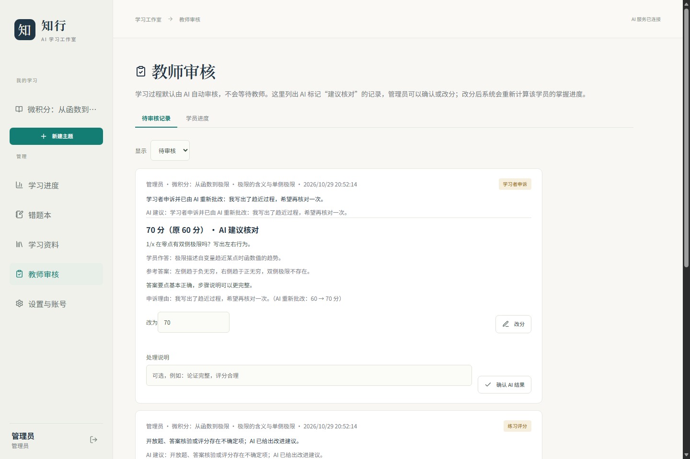

# 摘要

大学生自主学习一门新课程时，常见困难不是缺少资料，而是缺少一条与自身基础、目标和时间相匹配的学习路径，以及能够持续执行的练习与反馈。针对这一问题，本项目设计并实现了本机运行的多智能体智能授课软件“知行”：学生输入主题、基础、目标和每周可投入时间，系统通过起点测评了解学情，由诊断、规划、授课、练习、批改五个结构化角色生成个性化课程，并依据作答结果决定继续、补讲或完成。知识依赖图约束单元顺序，SymPy 核验可解析的数学表达式，AI 审核与教师审核通道共同约束评分结果。

项目交付 1.3.1 版本，包含 React 学生端与教师端、FastAPI 教学服务、SQLite 学习记录、12 单元微积分验收课程、36 道基准题、多账号与权限隔离、错题复习、阶段测验、评分申诉、教师改分、数据备份和 Windows 免安装程序。后端 136 项自动化测试、前端 13 项单元测试、15 项浏览器流程检查和 20 项发布包检查全部通过；三类合成学习者情景完成真实 DeepSeek API 的首单元五角色流程。项目形成了从建课、学习、反馈到教师复核的完整使用闭环，可作为个性化教学产品的可运行原型。

**关键词：** 多智能体；个性化学习；大语言模型；知识图谱；智能批改；本机应用

# 一、选题背景与需求分析

## 1.1 选题背景

在线课程和生成式人工智能已经能够提供大量学习资料，但“资料可得”并不等于“学习发生”。大学生在自学一门新课程时，通常要同时解决三个问题：

1. **顺序不清。** 不知道先学什么、后学什么，遇到难点时容易反复停滞，或者跳过必要的先修内容。
2. **难度不匹配。** 统一讲义和统一练习无法适配不同基础、目标和可投入时间，基础好的学生被拖慢，基础弱的学生被推着走。
3. **反馈不连续。** 听懂了却没有及时练习，答错后缺少针对性的错因分析和补讲，学习过程难以形成闭环。

普通的一次性大模型问答可以生成解释和题目，但每次对话彼此独立：它不持续记录学习状态，不约束先修关系，也不保证讲解、练习和评价使用同一套标准。将大模型直接放入教学流程，还会带来三个工程问题：生成结果格式不稳定、数学结论难以自动核验、评分依据难以追溯。

因此，本项目将需求归纳为三点：**生成个性化路径、形成教学闭环、提高过程可控性**。系统不追求替代教师，而是把重复性的诊断、组织、讲解、练习和初步批改交给模型与确定性工具，把最终判断保留给教师。

## 1.2 用户与使用场景

系统面向两类用户：

- **学生（学习者）：** 输入学习主题、已有基础、学习目标和每周时间，完成起点测评后按计划学习、做练习、看反馈、复习错题。
- **教师 / 管理员：** 管理账号与密钥，查看 AI 建议核对的评分记录，确认或改分，查看学员进度，备份数据。

典型场景是：一名只学过高中函数的大学生，希望用四周时间掌握单变量微积分的极限与导数基础。系统先通过前测确认其真实水平，再按先修关系安排单元顺序；每次练习后根据得分决定进入下一单元还是补讲；教师可以在管理端抽查评分并修正。

## 1.3 功能需求

| 编号 | 需求 | 说明 |
| --- | --- | --- |
| FR1 | 个性化建课 | 根据主题、基础、目标、时间与前测结果生成单元顺序、重点和时长 |
| FR2 | 教学闭环 | 诊断、规划、授课、练习、批改、补讲连续衔接，学习记录参与下一步决策 |
| FR3 | 过程可控 | 知识图谱约束先修关系；数学表达式独立核验；不确定结果标注并进入教师通道 |
| FR4 | 多账号与隐私 | 本机账号体系、数据隔离、密钥不落库、管理员备份与日志 |
| FR5 | 可交付 | Windows 免安装程序；源码可在 Windows / macOS / Linux 运行；离线测试可复现 |

## 1.4 非功能需求

- **本机优先：** 服务只监听 `127.0.0.1`，学习数据保存在本机 SQLite，不依赖云端账号体系。
- **失败可见：** 模型或网络故障时明确报错，不用模拟内容替代真实生成。
- **结果可追溯：** 每次角色调用保存输入、输出、模型、提示词版本、用量和时延；评分保留原分、修改分与审核意见。
- **可验证：** 后端、前端、浏览器流程和发布包均有自动化检查；测试使用确定性夹具，不把测试结果当作教学效果。
- **可维护：** 版本号单一来源；接口与数据结构有共享契约；发布脚本先跑测试再打包。

## 1.5 与任务书的对应

| 任务书要求 | 本项目实现 |
| --- | --- |
| 学情诊断 | 起点测评、澄清问题、未知掌握度保持未知 |
| 教学设计 | 依据前测、时间、先修图生成单元顺序与每单元重点 |
| 内容讲授 | 分层讲义、例题、易错点、来源引用、公式渲染 |
| 练习生成 | 按当前单元生成递进题、量规、三级提示与参考答案 |
| 作业批改 | 逐题评分、错因定位、SymPy 核验、AI 审核建议 |
| 反馈调整 | 未达 80% 进入补讲与新练习；错题按 1/3/7 天复习 |
| 多智能体分工 | 同一编排引擎中的五个结构化角色，职责与产物分离 |
| 教师复核 | 管理员确认或改分，改分后重算掌握度 |
| 对比与验证 | 离线回归、浏览器流程、真实 API 合成情景、发布包检查 |

# 二、总体方案设计

## 2.1 设计原则

系统遵循三条原则：

1. **模型负责生成，规则负责约束。** 大模型擅长理解自然语言和生成讲解，但不应独自决定先修顺序、数学等价和最终成绩。知识图谱、SymPy、状态机和审核策略承担可确定的部分。
2. **学习证据驱动下一步。** 前测决定计划，练习得分决定推进或补讲，教师改分触发掌握度重算。系统不按固定课时播放课程。
3. **人类判断保留入口。** AI 审核是默认路径，不阻塞学习；不确定结果标注 `ai_uncertain` 并进入教师通道，教师可以确认、改分或补充意见。

## 2.2 系统架构


系统分为四层：

- **前端：** React 19、TypeScript、Vite，KaTeX 渲染数学公式，Plotly 绘制函数图像；构建产物由后端静态提供。
- **接口层：** FastAPI 提供 REST 与 SSE 接口，Pydantic 约束请求和模型结构化输出；任务采用异步队列，支持进度、取消和 20 分钟超时。
- **教学引擎：** 五角色编排、知识图谱推进、SymPy 数学核验、审核策略、错题与阶段测验。
- **数据层：** SQLite 保存课程、任务、资料、错题、审核记录和账号；密钥只保存在进程内存或 Windows 凭据管理器。

## 2.3 五角色学习闭环


五个角色由同一编排引擎衔接，不是五个独立模型或五个自治进程：

| 角色 | 输入 | 输出 | 约束 |
| --- | --- | --- | --- |
| 诊断 diagnostic | 主题、基础、目标、时间、资料 | 澄清问题、3 道前测题、知识单元 | 未测知识保持未知，不虚构成绩 |
| 规划 planning | 前测结果、掌握度、先修图、时间 | 单元顺序、每单元分钟数与重点 | 只能引用允许的单元，后端补齐先修 |
| 授课 teaching | 当前单元、来源、历史错因 | 讲义、例题、易错点、引用 | 公式使用 KaTeX，引用真实来源 |
| 练习 assignment | 当前单元、已讲内容 | 2 道递进题、答案、量规、提示 | 不考未讲内容，参考答案提交前不下发 |
| 批改 grading | 学生答案、量规、独立核验 | 逐题得分、错因、补讲建议 | 尊重 SymPy 结果，不确定时标注 |

学习推进规则：某单元练习得分达到 80% 记为掌握，进入下一单元；未达到则生成补讲与新练习，再次提交后更新掌握度。前测中标记为不确定的题目不计为掌握。知识图谱决定可推进的单元集合，模型不能跳过先修。

## 2.4 知识与数学核验

- **课程：** `knowledge/calculus.json` 包含 12 个单元、36 道基准题、3 个开放来源（OpenStax Calculus Volume 1/2、MIT OCW 18.01SC）及先修关系。
- **知识图谱：** 单元以 `prerequisites` 构成有向无环图；规划与推进均读取该图，保证不会出现“未学先修却直接学习后继”的路径。
- **SymPy 核验：** 对可解析的表达式、极限、导数、积分和数值答案，在受限子进程中做等价判断；只接受可解析的数学表达式，开放题与过程题交给量规与 AI 审核。
- **审核策略：** 低置信度、缺失引用、核验失败或题意歧义的结果标记 `ai_uncertain`，同时给出 `ai_review` 建议并写入教师通道；学习流程继续，不等待人工。

## 2.5 账号、数据与权限

- 第一个创建的账号为管理员，可添加、停用、删除账号，重置密码，设置模型密钥。
- 每个账号的课程、任务、错题、资料和测验相互隔离；跨账号访问返回 404，避免探测资源是否存在。
- 密码使用 PBKDF2 哈希存储，会话令牌哈希存储，Cookie 为 HttpOnly、SameSite=Strict。
- 写请求校验同源 `Origin`，其他本机端口不能借用登录态。
- 管理员可以下载 SQLite 备份、查看脱敏错误日志、查看学员进度（不含作答内容）。
- 90 天未打开且无新学习记录的课程会在启动时清理；内置教材和用户上传资料保留到手动删除。

## 2.6 任务与接口

耗时的模型调用不作为同步请求处理，而是创建任务：

1. `POST /api/courses`、`POST /api/courses/{id}/diagnostic` 等接口返回 `task_id`。
2. 前端通过 `GET /api/tasks/{id}` 或 SSE 获取进度。
3. 任务完成写入课程记录；失败保留已有进度并返回可读错误。
4. 用户可以取消任务；超过 20 分钟自动停止。
5. 同一 `request_id` 幂等，避免重复提交产生多份记录。

完整接口见 `docs/API.md`。

# 三、技术路线与实施过程

## 3.1 技术选型

| 层次 | 技术 | 选择理由 |
| --- | --- | --- |
| 前端 | React 19 + TypeScript + Vite | 组件化、类型约束、构建快，便于做复杂学习工作区 |
| 数学显示 | KaTeX | 公式渲染快，适合讲义与题目 |
| 图像 | Plotly | 函数图像交互，满足微积分直观展示 |
| 后端 | FastAPI + Pydantic | 异步接口、结构化校验、自动文档 |
| 数据 | SQLite | 本机零配置、单文件备份、足够支撑单机课程 |
| 数学 | SymPy | 符号等价与极限/导数/积分核验 |
| 模型 | DeepSeek 官方 API | 中文教学生成稳定，JSON 输出可用 |
| 桌面 | PyInstaller | 免安装、无控制台、双击启动 |
| 测试 | pytest + Node test + Edge CDP | 后端、前端、浏览器流程分层验证 |

## 3.2 实施过程

| 阶段 | 目标 | 主要产出 | 验证 |
| --- | --- | --- | --- |
| 第一阶段 | 打通极限学习路径与五角色闭环 | 诊断、规划、授课、练习、批改；SQLite；CLI 与网页 | 后端用例、真实 API 合成情景 |
| 第二阶段 | 扩展到 12 单元与任意主题 | 微积分课程、知识图谱、资料上传与检索、续学 | 课程结构测试、前端构建 |
| 第三阶段 | 完善学习记录与教师治理 | 错题本、阶段测验、申诉、教师审核、进度统计 | 浏览器流程检查、账号隔离测试 |
| 第四阶段 | 完成多账号与桌面交付 | 账号体系、密钥设置、备份、错误日志、Windows 包 | 发布包 20 项检查、无控制台启动 |

## 3.3 版本演进

| 版本 | 主要变化 |
| --- | --- |
| 1.0 | 五角色闭环、SQLite、本地网页、Windows 启动器 |
| 1.1 | 运行时切换为 DeepSeek 官方 API；真实 API 合成情景验收；桌面启动修复 |
| 1.2 | 多账号与权限隔离、网页设置密钥、学习进度、错题本、阶段测验 |
| 1.3.0 | 教师审核与改分、单题申诉、学员进度、任务取消与超时、备份与错误日志 |
| 1.3.1 | 修复非微积分主题在前测后无法规划的问题；保留前测结果并从规划步骤续跑 |

## 3.4 1.3.1 的收尾工作

1.3.1 是本次结题的最终版本。该版本处理了任意主题建课在前测后规划失败的问题：前测评分和作答记录保留，课程可以从“继续规划课程”继续执行，不需要重新测评。版本号统一由 `learning/version.py` 提供，前端 `package.json`、发布包名称和页面状态接口均读取同一版本。

## 3.5 工程化与质量保证

- **单一版本源：** `learning/version.py` 是 API、桌面启动器、构建脚本和发布检查的唯一版本来源。
- **分层测试：** 后端 136 项 pytest；前端 13 项 Node 单元测试；15 项 Edge 无头浏览器流程检查；发布包 20 项检查。
- **离线优先：** 测试使用临时数据库、内存密钥库和 DeepSeek 离线桩，不触碰真实学习数据，不依赖网络。
- **发布门禁：** `scripts/build_windows.ps1` 先跑后端测试、前端构建和前端测试，任一失败即停止打包。
- **发布核验：** `scripts/verify_release.py` 在临时目录解压 ZIP，运行冻结 EXE 自检、真实本机 HTTP、登录、备份、网页退出和端口释放检查。
- **证据留存：** 测试输出、浏览器检查 JSON、截图和发布包哈希保存在 `evidence/`，报告中的数字可以回查。

# 四、系统实现与主要成果

## 4.1 学生端

- **新建主题：** 输入主题、基础、目标、每周时间、每次时长和偏好；可勾选已上传资料。
- **起点测评：** 生成 3 道诊断题，作答后形成真实学情；未测单元保持“未知”。
- **学习计划：** 展示单元顺序、每单元时长、重点和先修关系；知识地图同步显示掌握状态。
- **讲义与练习：** 分层讲义、例题、易错点、来源引用；练习按当前单元生成，附量规和三级提示。
- **反馈与补讲：** 逐题得分、错因、参考答案与核验依据；未达 80% 可生成补讲与新练习。
- **申诉：** 对某题评分有疑问可申诉一次，AI 重新批改该题，原分保留可见。
- **错题本：** 得分低于 80% 的题进入错题本，按 1、3、7 天安排复习。
- **阶段测验：** 12 单元课程提供前测、后测、延迟测，固定题，不计入日常练习。
- **学习助手：** 划选讲义文字提问，按提示层级逐步给思路，不直接泄露练习答案。
- **学习进度：** 掌握单元、练习次数、平均分、待复习错题；支持导出和删除课程。

## 4.2 教师与管理员端

- **教师审核：** 列出 AI 标记“建议核对”的记录，显示学生答案、参考答案、AI 建议和原分；可确认或改分。
- **掌握度重算：** 改分后重新计算该单元的掌握状态和课程进度。
- **学员进度：** 查看各账号的掌握单元、练习次数、平均分、待复习错题和模型用量，不显示作答与对话。
- **账号管理：** 添加、停用、删除账号，重置密码，设置角色。
- **密钥管理：** 先验证再保存 DeepSeek 密钥；可选择存入 Windows 凭据管理器或仅本次运行有效。
- **数据管理：** 下载数据库备份、查看脱敏错误日志、退出程序。

## 4.3 课程与题库

12 个单元覆盖从函数、极限到级数与泰勒近似的单变量微积分主线：

| 单元 | 主题 | 单元 | 主题 |
| --- | --- | --- | --- |
| u01 | 函数与定义域 | u07 | 导数、单调性与优化 |
| u02 | 极限的含义与单侧极限 | u08 | 原函数与不定积分 |
| u03 | 连续性与介值定理 | u09 | 定积分与微积分基本定理 |
| u04 | 导数定义与局部变化率 | u10 | 换元与分部积分 |
| u05 | 求导法则与链式法则 | u11 | 积分应用与反常积分 |
| u06 | 隐函数与相关变化率 | u12 | 数列、级数与泰勒近似 |

36 道基准题覆盖 12 个单元，包含表达式题与开放题；每题有答案、步骤、量规和核验规格。课程来源为 OpenStax Calculus Volume 1/2 与 MIT OCW 18.01SC，讲义生成时要求引用来源编号。

## 4.4 桌面交付

Windows 免安装包解压后双击 `ZhixingLearningStudio.exe` 即可使用：

- 无控制台窗口，启动后自动打开 `http://127.0.0.1:8877/`。
- 再次双击只重新打开页面；退出由管理员在网页“设置与账号”中操作。
- 学习数据保存在 `%LOCALAPPDATA%\ZhixingLearningStudio\learning.sqlite`。
- 首次使用创建管理员账号，然后在设置页填写 DeepSeek API Key。
- 忘记密码可在程序目录运行 `ZhixingLearningStudio.exe --reset-password 用户名`。
- 源码方式支持 Windows、macOS 和 Linux；前端已随仓库提供构建产物，只需 Python 3.11+ 即可运行。

## 4.5 主要成果

- 可运行的本机教学系统：学生端、教师端、管理端和桌面启动器。
- 12 单元微积分课程、36 道基准题、3 个开放来源与先修图。
- 五角色编排、知识图谱推进、SymPy 核验、AI 审核与教师改分。
- 多账号隔离、错题复习、阶段测验、申诉、备份、日志和任务管理。
- 完整的测试、浏览器检查、发布包核验和证据记录。




# 五、团队分工与协作

## 5.1 成员与职责

| 成员 | 负责模块 | 具体工作 | 交付物 |
| --- | --- | --- | --- |
| 汤家齐 | 教学引擎与模型编排；桌面交付与发布 | 前测、规划、授课、练习与批改流程；结构化输出、任务状态、版本管理；Windows 打包、发布核验与答辩材料 | 后端、桌面包、答辩 PPT |
| 张清波 | 前端界面与交互 | 课程页、学习进度、错题本、申诉、教师审核与设置页面；响应式布局、公式与图像展示、交互走查 | 前端、界面截图 |
| 吕绍康 | 知识库、数学核验与测试 | 12 单元课程、36 道题与量规；SymPy 核验；后端与浏览器测试；学习数据与备份检查 | 知识库、测试记录 |

## 5.2 协作方式

1. **接口先行。** 先在 `docs/API.md` 约定 API、数据结构和状态字段，前后端按契约并行开发。
2. **模块负责。** 每位成员对自己的模块和测试负责，跨模块改动先在接口层对齐。
3. **阶段联调。** 每个模块完成后立即接入主流程，避免最后集中返工。
4. **共同验收。** 关键流程由全组按真实使用顺序走查：建课、测评、学习、练习、申诉、教师改分、退出。
5. **版本记录。** 版本号单一来源，发布前统一跑后端、前端、浏览器和发布包检查，结果写入 `evidence/`。

## 5.3 具体贡献

- **汤家齐：** 搭建五角色编排与任务状态机，完成模型结构化输出、失败重试、任务取消与超时；实现教师审核、申诉和掌握度重算的后端流程；完成 Windows 打包、发布核验与答辩材料。
- **张清波：** 实现学习工作区、知识地图、练习反馈、错题本、教师审核和设置页面；完成 KaTeX/Plotly 展示、移动端布局和页面交互检查。
- **吕绍康：** 整理 12 单元课程、36 道题、量规与来源；实现 SymPy 核验用例和数学边界测试；维护后端测试、浏览器检查和学习数据备份检查。

# 六、操作演示

## 6.1 演示环境

- Windows 10/11，Edge 或 Chrome。
- 知行 1.3.1 Windows 免安装包，或源码方式 `start.cmd` / `./start.sh`。
- 管理员账号已创建，DeepSeek API Key 已在设置页验证并保存。
- 演示前预建一门“单变量微积分”课程，减少现场等待。

## 6.2 演示流程

| 步骤 | 操作 | 讲解重点 |
| --- | --- | --- |
| 1 | 双击 EXE，浏览器打开登录页 | 本机服务、无控制台、127.0.0.1:8877 |
| 2 | 新建主题：单变量微积分、高中基础、每周 3 小时 | 主题、基础、目标、时间如何进入建课参数 |
| 3 | 完成起点测评 | 未测单元显示“未知”；前测结果决定计划 |
| 4 | 打开学习计划、知识地图与讲义 | 先修关系、单元顺序、来源引用、公式渲染 |
| 5 | 提交一道练习，查看反馈 | 逐题得分、错因、参考答案、申诉入口 |
| 6 | 点击“补讲与新练习” | 未达 80% 时生成针对性补讲，而不是直接推进 |
| 7 | 打开教师审核，改一次分 | 原分保留、修改分生效、掌握度重算 |
| 8 | 查看学员进度、错题本、导出与退出 | 管理端统计不含作答内容；数据可备份 |

## 6.3 演示要点

- **知识地图**体现先修顺序，未测单元不会被伪装成已掌握。
- **练习反馈**同时展示得分、错因、参考答案和核验依据，评分可追溯。
- **申诉与教师改分**体现“AI 先审、教师可改”的治理路径，原分不会被覆盖。
- **学员进度**只展示统计，不展示作答和对话，兼顾教学管理与隐私。
- **桌面交付**证明系统不是只能跑在开发环境里的脚本。

## 6.4 现场异常处理

- 模型服务不可用时，页面明确显示失败原因，已保存的学习记录不受影响；可改用已保存课程继续演示。
- 8877 端口被占用时，关闭占用程序后重新启动；源码方式可用 `--port` 换端口。
- 演示机没有配置密钥时，先由管理员在设置页填写并验证；不要在演示中展示密钥内容。

# 七、项目总结与反思

## 7.1 完成情况

项目按四周任务书完成了从需求到交付的完整过程，最终版本为 1.3.1：

- 学生端支持任意主题建课、起点测评、个性化计划、讲义、练习、反馈、补讲、申诉、错题复习、阶段测验和学习助手。
- 教师端支持审核、改分、掌握度重算、学员进度、账号管理、密钥设置、备份与日志。
- 课程侧交付 12 单元、36 道题、3 个开放来源和先修图。
- 工程侧交付 Windows 免安装包、跨平台源码启动方式、自动化测试和发布核验记录。

## 7.2 亮点与创新

1. **学习闭环而非单轮问答。** 前测影响计划，练习影响掌握度，反馈影响补讲与推进；学习记录持续参与下一步决策。
2. **模型生成与确定性规则协同。** 知识图谱控制顺序，SymPy 核验数学表达式，状态机控制推进，AI 审核标注不确定性，教师保留最终改分入口。
3. **完整的学生—教师—桌面流程。** 不只是算法演示：账号、权限、申诉、审核、备份、日志、打包和发布核验均已打通。
4. **证据驱动的工程交付。** 后端、前端、浏览器和发布包分层验证，报告中的每个数字都能在 `evidence/` 中回查。

## 7.3 存在问题与不足

1. **复杂开放题的评价粒度仍可提高。** 当前以量规总分和分项得分为主，过程性步骤的细粒度判断还不够稳定。
2. **课程内容需要更多教师参与。** 讲义、例题、标准答案和量规已经可以进入教师审核通道，但大规模课程审定仍需教师投入。
3. **真实学生试用规模有限。** 现有验证以自动化回归、浏览器流程和合成情景为主，真实学生的前后测与延迟测样本还可以扩大。
4. **长任务的时间与成本仍有优化空间。** 五角色调用带来更完整的产物，也增加了等待时间和 token 消耗。

## 7.4 改进方向

- 为开放题补充过程性量规和分步核验，减少单一总分带来的误判。
- 建立教师共同备课与审定流程，优先复核高风险知识点和标准答案。
- 在真实课堂中开展前测—后测—延迟测，收集学习时长、完成率和保持率。
- 在不改变审核口径的前提下优化任务编排、上下文裁剪和缓存，降低长任务耗时与成本。
- 增加更多学科模板，验证系统从微积分扩展到其他课程时的可配置性。

## 7.5 经验收获

- **状态管理比单次生成更重要。** 教学系统的难点在于让诊断、计划、练习和反馈共享同一份学习状态。
- **结构化输出需要工程约束。** JSON Schema、重试、校验和失败提示缺一不可，否则模型输出无法进入业务状态机。
- **确定性工具是可信度的基础。** 知识图谱和 SymPy 能覆盖的部分不应交给模型猜测。
- **接口契约能显著降低协作成本。** 先约定数据结构和状态，再并行开发，联调问题明显减少。
- **测试和发布门禁是交付的一部分。** 只有把构建、浏览器流程和发布包检查串起来，才能保证“能演示”变成“能交付”。

# 八、结论

“知行”1.3.1 已经形成一套可运行、可演示、可复核的本机个性化教学系统。它以五角色学习闭环组织教学过程，以知识图谱和 SymPy 约束可靠性，以教师审核保留人类判断，以 Windows 免安装包完成交付。项目验证了多智能体结构在真实教学流程中的工程可行性，也为后续的真实课堂试用、开放题评价和课程共建提供了可继续迭代的基础。

# 附录

## 附录 A　验证记录

| 检查项 | 结果 | 记录位置 |
| --- | --- | --- |
| 后端自动化测试 | 136 passed | `pytest -q` |
| 前端单元测试 | 13 passed | `frontend/tests/*.test.mjs` |
| 浏览器端到端检查 | 15 / 15 | `evidence/browser-accounts-offline.json` |
| Windows 发布包检查 | 20 / 20 | `evidence/release-check-1.3.1.json` |
| DeepSeek 合成情景 | 3 / 3 完成首单元五角色流程 | `evidence/acceptance-deepseek-synthetic.json` |
| 课程规模 | 12 单元 / 36 题 / 3 来源 | `knowledge/calculus.json` |

## 附录 B　目录结构

```text
zhixing-learning-studio/
├─ learning/            后端：API、引擎、账号、数据库、核验、审核策略
├─ frontend/            React 前端与已构建的 dist
├─ knowledge/           12 单元微积分课程与题库
├─ tests/               后端 pytest
├─ scripts/             启动、构建、浏览器检查、发布核验
├─ docs/                结题报告、答辩 PPT、文稿、API 契约、用户指南
├─ evidence/            测试与发布证据、界面截图
├─ desktop.py           Windows 桌面启动器
├─ start.cmd / start.sh 一键启动
└─ requirements.txt     Python 依赖
```

## 附录 C　运行与配置

```powershell
# Windows 源码方式
.\start.cmd

# 或手动
python -m venv .venv
.\.venv\Scripts\python.exe -m pip install -r requirements.txt
.\.venv\Scripts\python.exe scripts\serve.py
```

```bash
# macOS / Linux
./start.sh
```

浏览器打开 `http://127.0.0.1:8877/`，首次创建管理员账号，然后在“设置与账号”填写 DeepSeek API Key。密钥只保存在进程内存或 Windows 凭据管理器，不写入数据库。

## 附录 D　课程来源

- OpenStax, *Calculus Volume 1*, <https://openstax.org/details/books/calculus-volume-1>
- OpenStax, *Calculus Volume 2*, <https://openstax.org/details/books/calculus-volume-2>
- MIT OpenCourseWare, *18.01SC Single Variable Calculus*, <https://ocw.mit.edu/courses/18-01sc-single-variable-calculus-fall-2010/>
